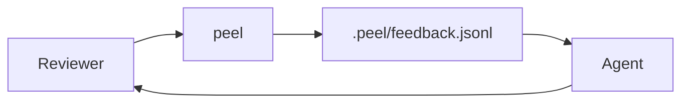

# ADR: Agent Feedback Pipeline

Record of the decision to use `.peel/feedback.jsonl` as the agent feedback channel.

See [[architecture]] for the system overview and [[decisions]] for prior context.

## Flow

## Consequences

- Feedback is append-only JSONL; agents poll or watch the file.
- Quotes carry line numbers for precise anchoring.
