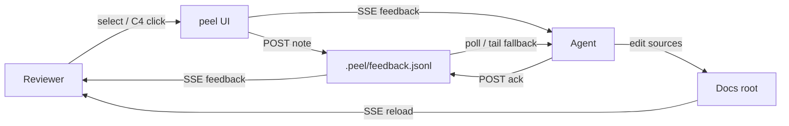

# ADR: Agent feedback pipeline

Record of the decision to use `.peel/feedback.jsonl` as the human↔agent review channel.

See [[architecture]] for the system overview and [[decisions]] for related choices. Contract: [[feedback-contract]]. Playbook: [[agent-loop]].

## Status

Accepted (and evolved): append-only typed events + SSE wake-ups + portable `peel_api.py`.

## Context

Docs reviews died in chat screenshots. Agents can edit files but needed durable quotes, ids, and a clear “done” signal without turning peel into a ticket tracker.

## Decision

1. **Append-only JSONL** under `<root>/.peel/feedback.jsonl` — only the server writes (`id` / `ts` owned).
2. **Typed events** — `note` / `ack` / `tombstone`; open set derived by folding (no PATCH of history).
3. **HTTP is the write path** — `POST` / `DELETE` `/api/feedback`; agents never hand-edit the file.
4. **SSE wake-ups** — `GET /events` emits `feedback` after append and `reload` after doc changes; file tail remains a fallback.
5. **One portable client** — `skills/peel/peel_api.py` so agents under shell approval use one executable for health / wait / ack / pair.

## Flow

## Consequences

- Feedback survives restarts; gitignoring `.peel/` keeps smoke notes out of PRs.
- Quotes + anchors (`headingId`, `slide`, `c4Id` / Rel endpoints) beat brittle line-only matching.
- No chat threads — one note, one close (`ack` or tombstone).
- Browser toasts and Feedback tabs (open / acked / dismissed) are the human status surface.
