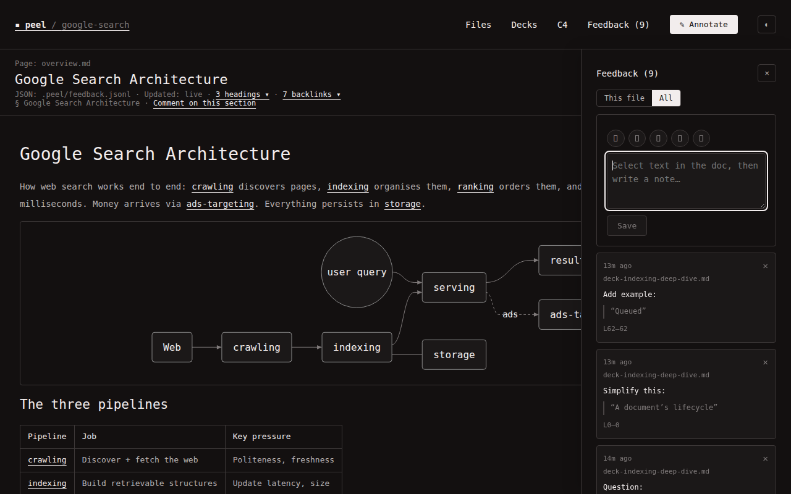

# Annotate a doc

Select text in the reader (docs, decks, or C4 labels). Peel captures the quote, optional anchors, and your note into an append-only log agents can finish.

## Capture

1. Drag-select text — a composer appears near the selection. On C4, **click** a box or Rel instead (double-click drills).
2. Pick a chip (**Fix this**, **Explain this**, **Add example**, **Simplify this**, **Question**) or type freely.
3. Press `⌘↵` / `Ctrl↵` or click **Save**.

Saving needs a quote and a note. Closing the composer without save drops the draft. There is no separate Annotate nav button — Feedback (`]`) reviews the queue.

## Review

Open **Feedback** (`]`). Tabs:

| Tab | Meaning |
|---|---|
| **Open** | Active notes — marks in the doc |
| **Acked** | Agent finished (`type: ack`) |
| **Dismissed** | You discarded (`type: tombstone`) |
| **All** | History for the current scope |

**This file** vs all files filters the list. Click a row to jump to the quote. Click `×` to dismiss (tombstone), not hard-delete.

## Agent side

Each save appends one JSON line under `<root>/.peel/feedback.jsonl`. Agents should edit sources, then `POST` an `ack` with `ref` set to the note id. Playbook: [[agent-loop]]. Contract: [[feedback-contract]].

## Anchors

Notes may carry `headingId`, `slide`, `level`, `levelKind`, `c4Id` / `c4Label` / `c4From` / `c4To`, and line ranges so agents can find the quote after edits. Prefer matching on `quote` (or `c4Id` / Rel endpoints) when lines drift.

## Screenshots

