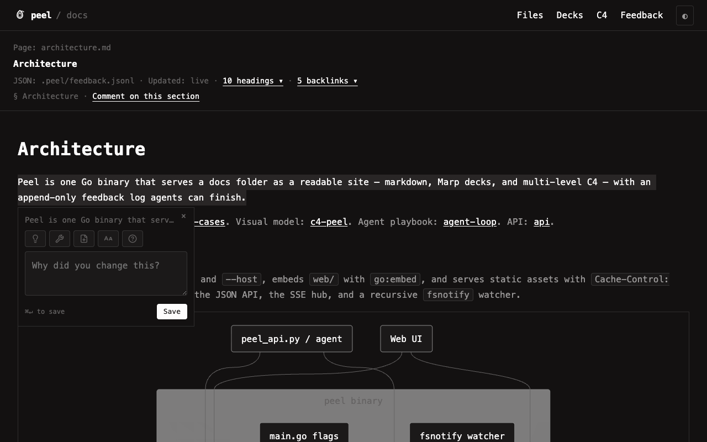
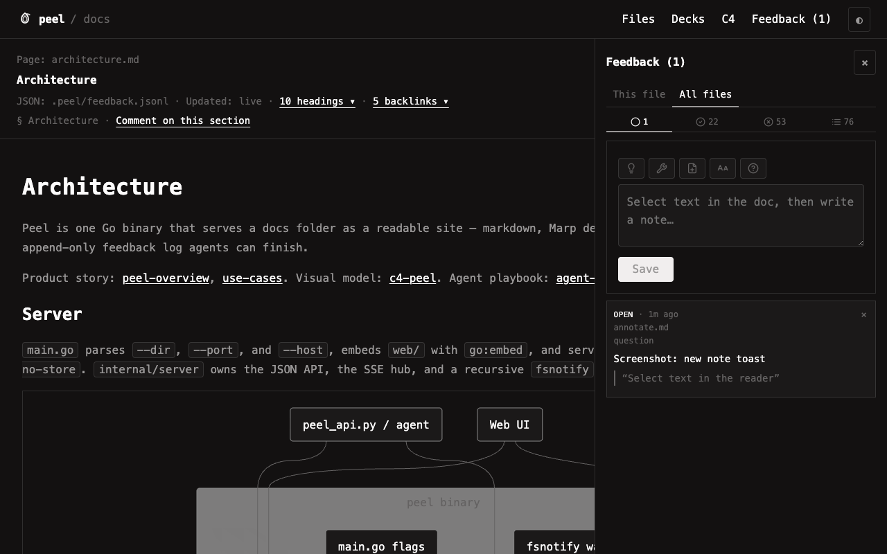
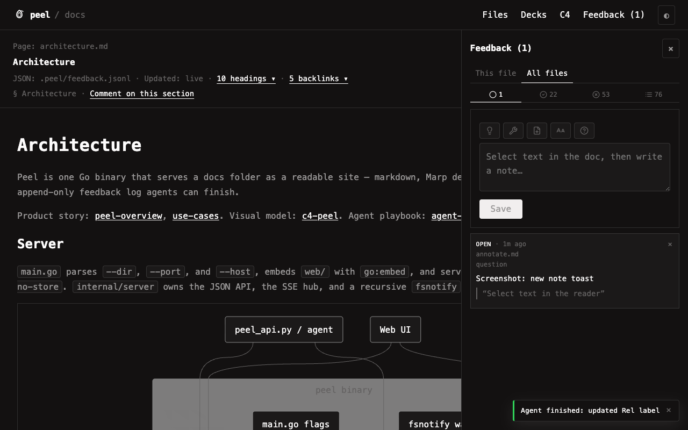

# Annotate a doc

Select text in the reader (docs, decks, or C4 labels), or **click** a C4 box/Rel. Peel captures the quote, optional anchors, and your note into an append-only log agents can finish.

## Capture

1. **Docs / decks:** drag-select text — a composer appears near the selection.  
   **C4:** click a box or relationship (double-click drills). You can still select label text.
2. Pick a chip (**Fix this**, **Explain this**, **Add example**, **Simplify this**, **Question**) or type freely.
3. Press `⌘↵` / `Ctrl↵` or click **Save** (compact button in the composer / Feedback card).

Saving needs a quote and a note. Closing without save drops the draft. There is no separate **Annotate** nav button — use selection/click and review in Feedback (`]`).

## Review

Open **Feedback** (`]`). Tabs:

| Tab | Meaning |
|---|---|
| **Open** | Active notes — peach marks in the doc |
| **Acked** | Agent (or human) finished (`type: ack`) — shows `ack: …` when provided |
| **Dismissed** | You discarded (`type: tombstone`) |
| **All** | History for the current scope |

**This file** vs **All files** filters the list. Click a row to jump toward the quote. Click `×` to dismiss (tombstone), not hard-delete.

## Activity toasts

Bottom-right toasts fire on SSE `feedback` / `reload` for the open file:

| Event | Toast |
|---|---|
| Agent `ack` | “Agent finished: …” (click opens Acked) |
| Tombstone | “Note dismissed” |
| Remote note | “New note · …” (own saves are quiet briefly) |
| Doc reload | “Doc updated · path” |

## Agent pulse

When an agent calls `peel_api.py busy "…"`, the peel mark pulses and a short status chip appears next to the logo. `ack` / `idle` clears it.

## Agent side

Each save appends one JSON line under `<root>/.peel/feedback.jsonl`. Prefer [`skills/peel/peel_api.py`](../skills/peel/peel_api.py) (`wait-note` / `ack` / `pair`). Playbook: [[agent-loop]]. Contract: [[feedback-contract]].

## Anchors

| Field | When |
|---|---|
| `headingId` | Markdown section |
| `slide` | Deck (1-based) |
| `level`, `levelKind` | C4 level |
| `c4Id`, `c4Label` | C4 node or Rel id / label |
| `c4From`, `c4To` | Rel endpoints |
| `startLine`, `endLine` | Best-effort source lines |

Prefer `quote` (or `c4Id` / Rel endpoints) when lines drift.
