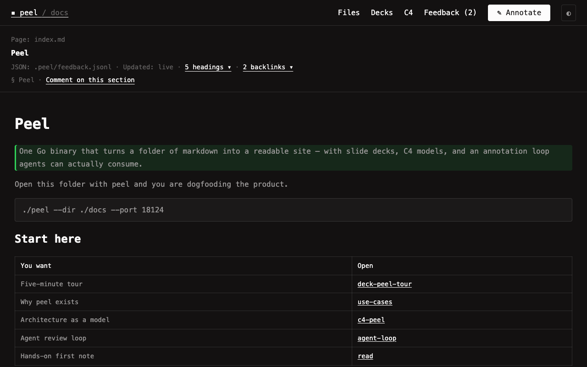

# Architecture

Peel is one Go binary that serves markdown as a readable site. The whole UI ships inside the binary, so deploying peel means copying one file.

Product story and jobs: [[peel-overview]], [[use-cases]]. Visual model: [[c4-peel]].

## Server

`main.go` parses `--dir`, `--port`, and `--host`, then embeds `web/` with `go:embed` and serves it as static files with `Cache-Control: no-store`. `internal/server` holds the JSON API, the SSE channel, and a recursive `fsnotify` watcher. Any write under the docs root broadcasts `{type: "reload", path}` on `/events`. The browser refreshes the file list on every event and re-opens the open doc when its path matches.

Markdown rendering is server side with goldmark (GFM, footnotes, typography, unsafe HTML for diagrams and links). `[[name]]` wikilinks resolve by basename, case-insensitively, before Goldmark runs. After HTML render, relative `[label](./doc.md)` and `.c4` links become SPA `?file=` anchors (`data-doclink`); `http(s):` links get `target=_blank` and `rel=noopener noreferrer`. Backlinks scan both `[[wikilinks]]` and local Markdown doc links.

## Modes

The frontmatter or extension picks the view. Plain `.md` renders as a doc. `marp: true` splits the body on `---` lines into a slide deck. `.c4` files split the same way into C4 levels, one mermaid C4 block each, rendered client side.

## Client

`web/app.js` is one Alpine component, `peelApp`. It fetches `/api/files` and `/api/doc`, keeps selection quotes, posts feedback, and syncs `?file=`, `&slide=`, and `&level=` into the URL. `Ctrl/Cmd-P` opens a centered Goto Anything palette with fuzzy path matching. Diagrams render client side with the vendored `pele` bundle (`web/vendor/pele.global.js`), which parses mermaid syntax to inline SVG. Title strips, scroll-spy, drill-down, and zoom are plain DOM code around those SVGs.

