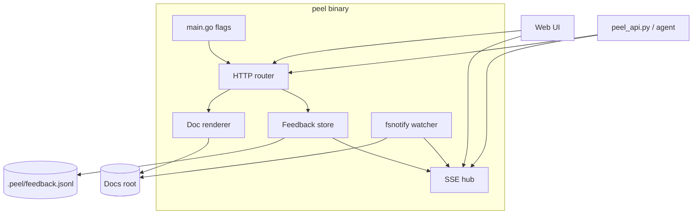
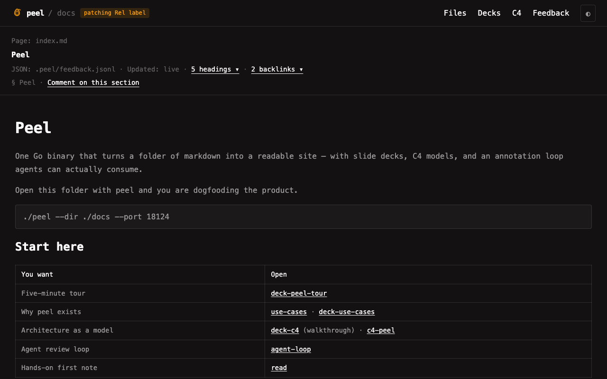

# Architecture

Peel is one Go binary that serves a docs folder as a readable site — markdown, Marp decks, and multi-level C4 — with an append-only feedback log agents can finish.

Product story: [[peel-overview]], [[use-cases]]. Visual model: [[c4-peel]]. Agent playbook: [[agent-loop]]. API: [[api]].

## Server

`main.go` parses `--dir`, `--port`, and `--host`, embeds `web/` with `go:embed`, and serves static assets with `Cache-Control: no-store`. `internal/server` owns the JSON API, the SSE hub, and a recursive `fsnotify` watcher.

### Live events (`GET /events`)

| `type` | When | Consumer |
|---|---|---|
| `reload` | `.md` / `.c4` under the root changes | Browser re-fetches `/api/doc` (+ toast) |
| `feedback` | After note / ack / tombstone append | Browser Feedback + toasts; `peel_api.py wait-note` |

Comment heartbeats (`: hb`) keep the stream alive. Durable truth stays in `.peel/feedback.jsonl` and the docs tree — SSE is a wake-up channel.

### Markdown pipeline

Goldmark (GFM, footnotes, typography, unsafe HTML for diagrams). `[[name]]` wikilinks resolve by basename (case-insensitive) before Goldmark. After HTML render, relative `[label](./doc.md)` / `.c4` links become SPA `?file=` anchors; `http(s):` links open in a new tab. Backlinks count both wikilinks and local Markdown doc links.

### Feedback fold

Open notes = events with `type` note (or empty) that have no later `ack` / `tombstone` with matching `ref`. `GET /api/feedback` returns the fold; `?all=1` returns the raw log. Deletes append tombstones — the file is never rewritten. Contract: [[feedback-contract]].

## Modes

Frontmatter / extension picks the view. JSON also exposes `type`: `doc` \| `deck` \| `c4`.

| Signal | Mode |
|---|---|
| plain `.md` | Document reader |
| `marp: true` | Deck — body split on `---` into slides |
| `.c4` | C4 — each `---` section is one mermaid C4 block (client-rendered) |

C4 kind mapping: `C4Dynamic` → UI kind **Code**; `C4Deployment` → **Deployment**. Spec: [[c4-format]].

## Client

`web/app.js` is one Alpine component (`peelApp`). It loads `/api/files` and `/api/doc`, posts feedback, syncs `?file=` / `&slide=` / `&level=`, and listens on `/events`.

Notable UX:

- **Goto Anything** — `Ctrl/Cmd-P` or `K`, fuzzy path match
- **Composer** — selection (or C4 click) → chips → compact Save
- **Feedback drawer** — open / acked / dismissed / all; peach marks for open notes only
- **Toasts** — agent ack, dismiss, remote note, current-file reload
- **C4** — click box/Rel to comment; double-click box to drill

Diagrams use the vendored `pele` bundle (`web/vendor/pele.global.js`). Icons are Lucide sprites.

## Agent surface

Portable skill: [`skills/peel/`](../skills/peel/SKILL.md) (`peel_api.py` over stdlib HTTP/SSE). Cursor’s `/peel` is a thin wrapper under `.cursor/skills/peel/`. Prefer the script over ad-hoc curls so one shell approval covers every subcommand.

## Package map

| Path | Role |
|---|---|
| `main.go` | Flags, embed, listen |
| `internal/server/server.go` | Router, SSE hub, watcher |
| `internal/server/doc.go` | Render / slides / C4 levels |
| `internal/server/files.go` | Listing, titles, kinds, link counts |
| `internal/server/feedback.go` | Validate, append, fold, emit |
| `internal/server/links.go` | Wikilink + local link graph |
| `web/` | Alpine UI + pele + Lucide |
| `skills/peel/` | Portable agent skill |

## Screenshots

