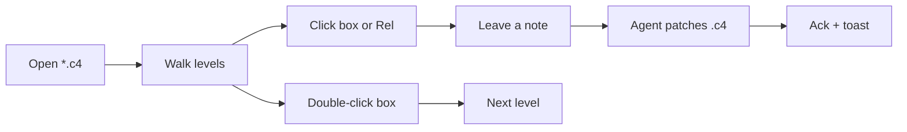

# C4 in the AI era

Architecture that agents can **read, comment, and patch**.

Model: [[c4-peel]] · Spec: [[c4-format]] · Guide: [[view-c4]]

---

## What is C4?

A simple way to draw software at **four zoom levels**:

| Level | Question it answers |
|---|---|
| **Context** | Who uses the system? What else does it talk to? |
| **Container** | What apps / services / DBs make it up? |
| **Component** | What are the major pieces inside one container? |
| **Code** | How does a critical piece work? |

You stop drowning in one giant box-and-line spaghetti chart.

---

## Why it matters now

Agents are great at editing text.
They are bad at guessing architecture from a Slack screenshot.

C4 gives them:

- **Stable ids** (`user`, `api`, Rel endpoints)
- **Zoom** — comment at the right altitude
- **A shared map** humans and agents point at together

Peel turns that map into a live review loop.

---

## One `.c4` file, many levels

Levels are plain text blocks, separated by a line with exactly three dashes:

````markdown
C4Context
title Search — context
Person(user, "User", "…")
System(search, "Search", "…")
Rel(user, search, "queries")
---
C4Container
title Search — containers
Container(api, "API", "…")
````

Open [[c4-peel]] → URL `?file=c4-peel.c4&level=2`

---

## Kind icons (what peel shows)

| You write | Icon / kind |
|---|---|
| `C4Context` | Context |
| `C4Container` | Container |
| `C4Component` | Component |
| `C4Code` or `C4Dynamic` | Code |
| `C4Deployment` | Deployment |

Use `←` / `→` or the level dropdown to walk the zoom stack.

---

## How to use it in peel



| Gesture | Result |
|---|---|
| **Click** | Comment (composer + anchors) |
| **Double-click** box | Drill one level deeper |
| Select label text | Same comment path as docs |

---

## What the agent actually sees

```json
{
  "file": "c4-peel.c4",
  "level": 1,
  "levelKind": "Context",
  "c4Id": "user-peel",
  "c4From": "user",
  "c4To": "peel",
  "c4Label": "CLI + browser",
  "note": "Mention SSE on this Rel"
}
```

Prefer **`c4Id` / Rel endpoints** over line numbers after the diagram moves.

---

## A five-minute walk on peel itself

Open [[c4-peel]] and try this once:

1. **Context** — who talks to peel (you, agent, docs root)
2. **Containers** — CLI, API, watcher, UI, log, skill
3. **Components** — web shell vs Go server
4. **Dynamics** — reload path · note → ack path
5. **Code** — how open notes are folded

Click a relationship. Save a **Question**. Pair an agent.

---

## Pairing (logo will pulse)

```sh
./peel --dir ./docs --port 18124
skills/peel/peel_api.py pair --timeout 600
# when handling a note:
skills/peel/peel_api.py busy "patching Rel label" <note-id>
skills/peel/peel_api.py ack <note-id> "updated"
```

Playbook: [[agent-loop]] · Presence: pulsing peel mark in the header

---

## Takeaway

C4 is not bureaucracy — it is a **shared zoomable map**.

In the AI era, the map that lives in git (and that agents can ack against) beats the diagram buried in a slide deck.

Next: open [[c4-peel]] · read [[c4-format]] · leave one note.
