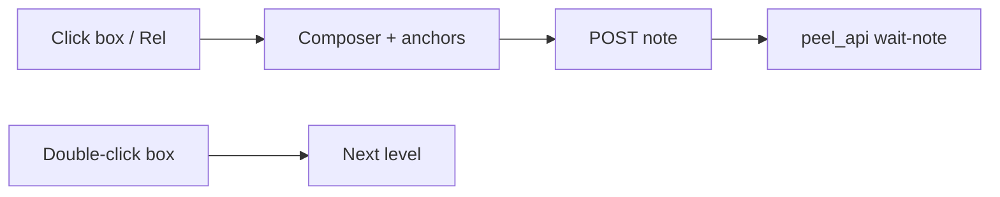

# C4 in peel

Click to comment.
Double-click to drill.
Agents patch `.c4` by id.

Model: [[c4-peel]] · Spec: [[c4-format]]

---

## One file, many levels

```
C4Context
title …
---
C4Container
title …
---
C4Component
title …
```

URL: `?file=c4-peel.c4&level=3`

---

## Kind icons

| Directive | Kind |
|---|---|
| `C4Context` | Context |
| `C4Container` | Container |
| `C4Component` | Component |
| `C4Code` / `C4Dynamic` | Code |
| `C4Deployment` | Deployment |

---

## Gestures



---

## Anchors agents see

```json
{
  "file": "c4-peel.c4",
  "level": 1,
  "levelKind": "Context",
  "c4Id": "user-peel",
  "c4From": "user",
  "c4To": "peel",
  "c4Label": "CLI + browser"
}
```

Prefer `c4Id` / endpoints over line numbers after edits.

---

## Walk the dogfood model

1. Context — people, peel, agent, docs root  
2. Containers — CLI, API, watcher, UI, log, skill  
3. Components — web shell vs Go server  
4. Dynamics — reload path · note→ack path  
5. Code — fold / open set

Open [[c4-peel]] and leave a note on a Rel.

---

## Pairing

```sh
./peel --dir ./docs --port 18124
skills/peel/peel_api.py pair --timeout 600
```

Playbook: [[agent-loop]]
