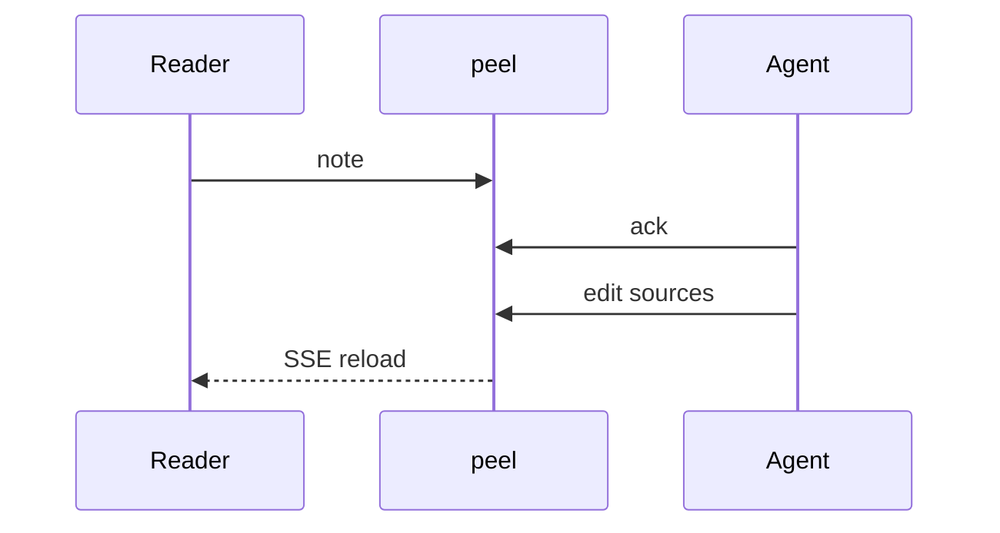

# Demo deck

Minimal slide stack for smoke-testing deck mode.
For the real pitch, use [[deck-peel-tour]] or [[deck-use-cases]].

---

## Diagram slide

---

## Done

Open [[annotate]] and leave a note on this line.
