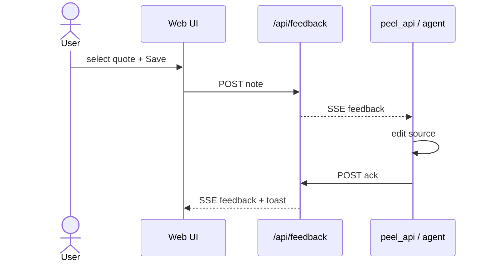

# Loop smoke deck

Minimal slides to exercise deck mode + the agent loop.
Pitch decks: [[deck-peel-tour]] · [[deck-use-cases]]

---

## The happy path

---

## Leave a note on this line

Select the sentence below, chip **Fix this**, Save.
Then pair an agent with `skills/peel/peel_api.py wait-note`.

> Smoke target: this paragraph should become clearer after an agent ack.

Guide: [[annotate]] · [[agent-loop]]
