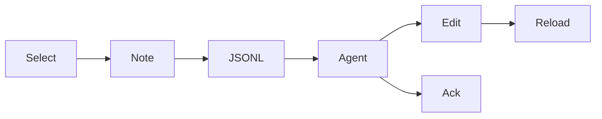

# Peel in five minutes

One binary. Docs, decks, and C4.
Notes that agents can finish.

---

## The problem

Docs rot. Reviews live in chat.
Agents can edit files — they need a queue with quotes, not a screenshot in Slack.

---

## The bet

Put the queue **next to the doc**.
Select → note → JSONL → agent → ack → reload.

See [[agent-loop]].

---

## Three modes, one binary

| Mode | Source | Feel |
|---|---|---|
| Doc | `*.md` | Read, link, search |
| Deck | `marp: true` | Present with ←/→ |
| C4 | `*.c4` | Levels, zoom, drill |

Hub: [[index]] · Model: [[c4-peel]]

---

## The loop



Full contract: [[feedback-contract]].

---

## Notes are events

```json
{ "type": "note", "action": "fix", "quote": "…", "note": "…" }
{ "type": "ack", "ref": "<id>", "note": "patched" }
{ "type": "tombstone", "ref": "<id>" }
```

Open / acked / dismissed — same drawer.

---

## Jobs peel wins

- Architecture review on a C4 model
- Agent doc-fix loop while reading
- Onboarding via a deck, deep-links into specs
- Spec + implementation annotated together

Stories: [[use-cases]].

---

## Keys worth memorizing

| Key | Action |
|---|---|
| `Ctrl/Cmd-P` or `K` | Goto Anything |
| `[` `]` | Files / Feedback |
| `←` `→` | Slide or C4 level |
| `⌘↵` | Save composer |

---

## Try it on this folder

```sh
./peel --dir ./docs --port 18124
```

Leave a note on the next slide. Watch Feedback.

---

## Next

Open [[c4-peel]] and click through levels.
Then [[agent-loop]] if you wire an agent today.
