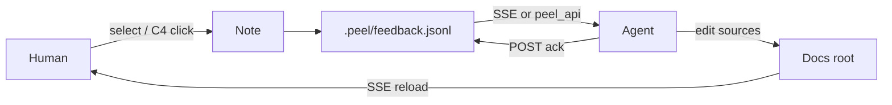

# Peel in five minutes

One binary. Docs, decks, and C4.
A note queue agents can finish.

---

## The problem

Docs rot. Reviews die in chat.
Agents can edit files — they need **quotes and ids**, not a Slack screenshot.

---

## The bet

Keep the queue **beside the doc**.



Playbook: [[agent-loop]] · Skill: `skills/peel/`

---

## Three modes, one shell

| Mode | Source | Interaction |
|---|---|---|
| Doc | `*.md` | Read, wikilinks, Goto |
| Deck | `marp: true` | ← / → slides |
| C4 | `*.c4` | Click = comment, dblclick = drill |

Hub: [[index]] · Model: [[c4-peel]]

---

## Notes are typed events

```json
{ "type": "note", "action": "fix", "quote": "…", "note": "…" }
{ "type": "ack", "ref": "<id>", "note": "patched" }
{ "type": "tombstone", "ref": "<id>" }
```

Drawer: **Open** · **Acked** · **Dismissed** · **All**
Contract: [[feedback-contract]]

---

## Pair without curl spam

```sh
skills/peel/peel_api.py pair --timeout 600
```

One script → health, catch-up, wait, ack.
Works for **any** coding agent (Cursor `/peel` is only a thin wrapper).

---

## What you will notice in the UI

- Peach marks on **open** quotes
- Toast when the agent **acks** (click → Feedback)
- Toast when the open **doc reloads** after an edit

---

## Keys

| Key | Action |
|---|---|
| `Ctrl/Cmd-P` or `K` | Goto Anything |
| `[` `]` | Files / Feedback |
| `←` `→` | Slide or C4 level |
| `⌘↵` | Save composer |
| Esc | Close composer / Goto |

---

## Try it on this folder

```sh
./peel --dir ./docs --port 18124
```

Leave a note on the next deck. Open Feedback.

---

## Next

1. Walk [[c4-peel]] — or the short [[deck-c4]] first.
2. Wire [[agent-loop]] with `peel_api.py`.
3. Skim jobs in [[deck-use-cases]].
