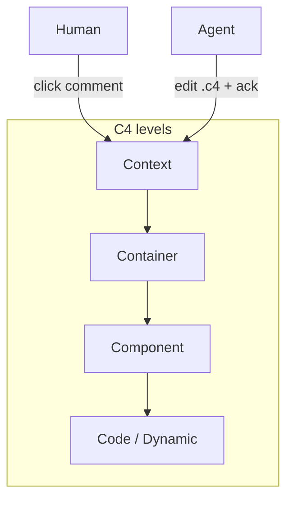
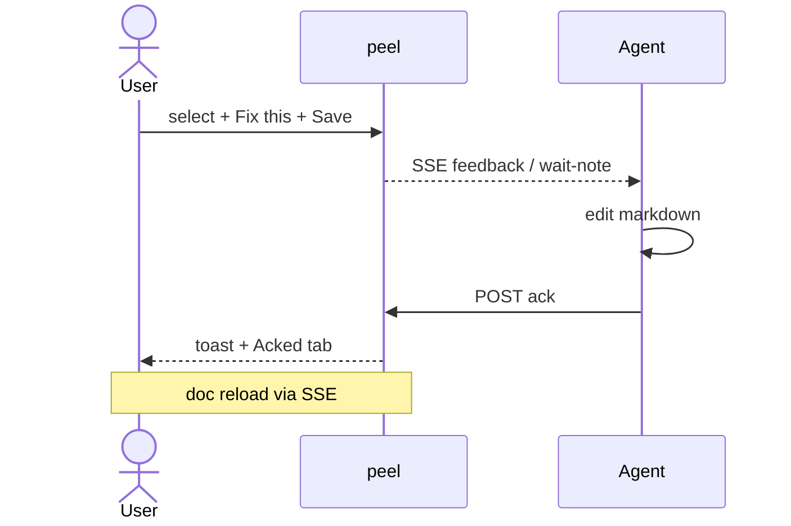
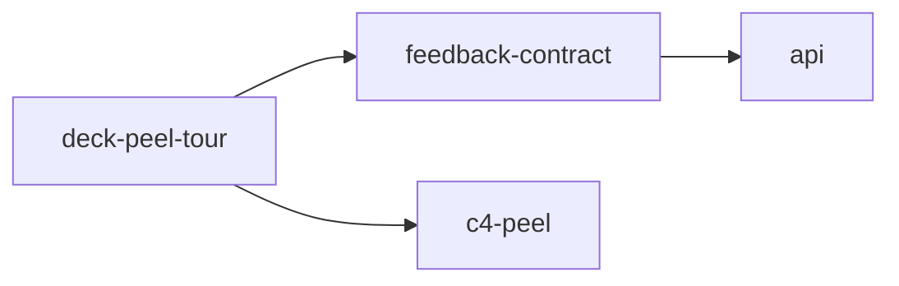

# Four jobs for peel

Architecture review.
Agent doc fixes.
Onboarding decks.
Spec beside the build.

Long form: [[use-cases]]

---

## 1 · Architecture review

Open a dedicated `*.c4` model.
Walk levels. **Click** to comment. **Double-click** to drill.
Agents patch `.c4` using `c4Id` / Rel endpoints.

Model: [[c4-peel]] · Gestures: [[deck-c4]]



---

## 2 · Agent fix loop



Playbook: [[agent-loop]]

---

## 3 · Onboarding as a deck

Present with ← / →.
`Ctrl/Cmd-P` jumps into a deep spec without leaving peel.

Tour: [[deck-peel-tour]]



---

## 4 · Spec beside the build

Keep [[feedback-contract]] or [[c4-format]] open.
Annotate ambiguities.
Agent updates Go handlers **and** the markdown in one pass.

---

## Status lives in the drawer

| Tab | Meaning |
|---|---|
| Open | Work queue + peach marks |
| Acked | Agent finished (`ack: …`) |
| Dismissed | You hit × (tombstone) |
| All | Full history for scope |

---

## Not for

Wiki hosting. Ticket tracking. Multi-tenant CMS.

Peel is the thin loop: **quote → note → edit → ack**.

---

## Run the dogfood

```sh
./peel --dir ./docs --port 18124
skills/peel/peel_api.py pair --timeout 600
```

Leave a note here. That is the product.
