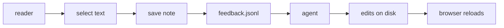

# Peel overview

Peel is one Go binary. It serves `*.md` as docs, `marp: true` files as slide decks, and `*.c4` files as C4 models. Readers select text and save notes. Each save appends to `.peel/feedback.jsonl`, which agents read.

## Modes

- Docs: rendered markdown with outline and backlinks.
- Decks: `---` sections become focusable slides. See [[deck-peel-tour]].
- C4: one C4 block per level with drill-down and zoom. See [[c4-peel]].

## Project map

Entry hub: [[index]]. Full doc set: [[read]]. Internals: [[architecture]].
