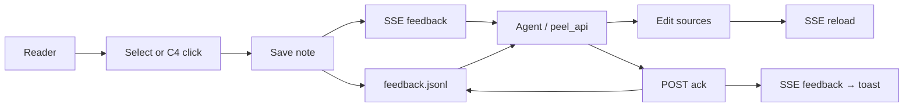

# Peel overview

Peel is a **docs browser for humans and coding agents**. One static Go binary serves a folder of files. Readers annotate what is wrong or unclear. Agents wake on SSE (or poll), edit the sources, and ack the notes. The browser live-reloads when the files change.

It is not a CMS, not a wiki host, and not a ticket tracker. It is the thinnest useful loop between “this paragraph is wrong” and “the agent fixed it.”

## What you get

| Surface | Files | In the UI |
|---|---|---|
| Docs | `*.md` | Reader, outline, backlinks, Goto Anything |
| Decks | `marp: true` + `---` | Slide focus, ←/→, strips |
| C4 | `*.c4` + `---` levels | Level picker, zoom, click=comment, dblclick=drill |
| Notes | `.peel/feedback.jsonl` | Composer, chips, open/acked/dismissed, toasts |

## The loop

Notes are an **append-only event log**: `note`, `ack`, and `tombstone`. Open notes are derived by folding. Full contract: [[feedback-contract]].

## Why dogfood `docs/`

This folder *is* the demo. Use cases, focused decks, and the C4 model should look like something you would ship to a team — not a stub. When the story is solid, screenshots in [[annotate]] and [[view-c4]] stay honest.

## Map

| Job | Open |
|---|---|
| Jobs peel wins | [[use-cases]] · [[deck-use-cases]] |
| Five-minute pitch | [[deck-peel-tour]] |
| C4 gestures | [[deck-c4]] · [[c4-peel]] |
| Agent day-in-the-life | [[agent-loop]] |
| How to run | [[serve]] · [[read]] |
| Specs | [[api]] · [[feedback-contract]] · [[c4-format]] · [[architecture]] |
