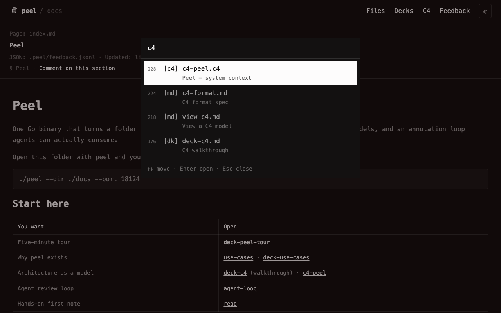

# Read docs with peel

Serve a folder, open a page, leave a first note. You need Go and a markdown tree.

## Serve this dogfood folder

```sh
make build
./peel --dir ./docs --port 18124
```

Open `http://127.0.0.1:18124/`. You get Files, the hub [[index]], and empty side panels until you annotate.

Fixture alternative (search-domain sample):

```sh
./peel --dir fixtures/google-search --port 18125
```

## Read a page

Click a file or press `Ctrl-P` / `Ctrl-K` (`Cmd` on macOS) to open **Goto Anything**. Type a few letters, ↑↓ to move, Enter to open. Use **Files**, **Decks**, or **C4** in the top bar for the left drawer tabs.



Worth opening once: [[use-cases]], [[deck-peel-tour]], [[c4-peel]], [[deck-c4]].

## Save a first note

1. Drag-select a sentence (or click a C4 box/Rel).
2. Chip **Fix this** (or type your own note).
3. `⌘↵` / **Save**.
4. Open **Feedback** (`]`) — the note is **Open**.

It was appended to `docs/.peel/feedback.jsonl` (or the fixture’s `.peel/`):

```sh
tail -n 1 docs/.peel/feedback.jsonl
```

Pair an agent:

```sh
skills/peel/peel_api.py pair --timeout 600
```

Next: [[annotate]] for the full UI, [[agent-loop]] to wire an agent, [[view-c4]] for click vs drill.
