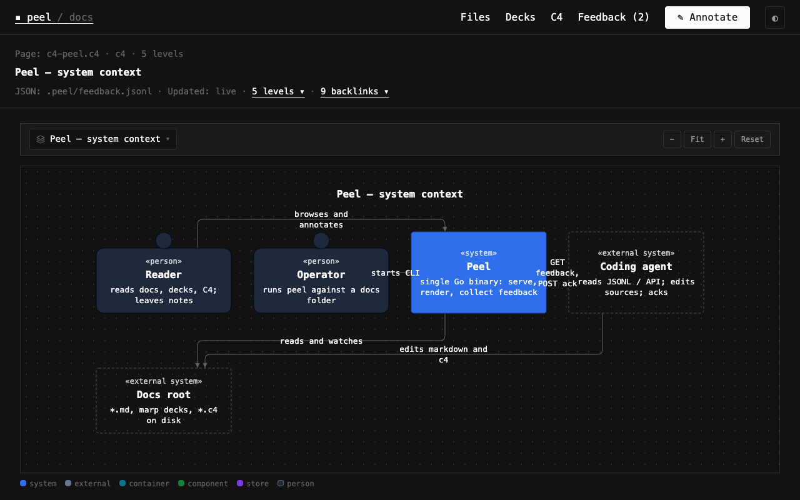

# View a C4 model

C4 files end in `.c4` and hold one diagram per level (split on `---`). Spec: [[c4-format]]. Dogfood model: [[c4-peel]].

## Switch levels

Use the level dropdown (kind icons for context / container / component / dynamic / code) or press `←` / `→`. The breadcrumb shows where you are. The URL carries `?file=….c4&level=2`, so levels are shareable.

## Comment or drill

**Click** a box or relationship to open the comment composer (anchors include `c4Id` / `c4Label`, and `c4From`/`c4To` for Rel edges). **Double-click** a box to go one level deeper. The outline jumps directly to a named level. You can still select label text to comment.

## Zoom

`−`, **Fit**, `+`, **Reset**. Canvas fits width on open and on level switch. Manual zoom disables auto-refit until **Fit**.

