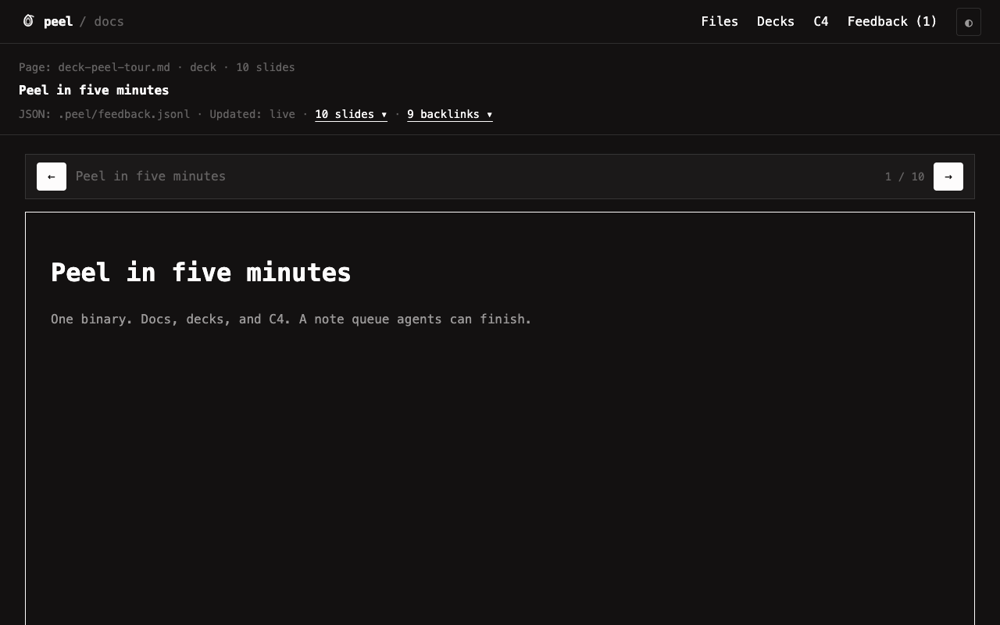
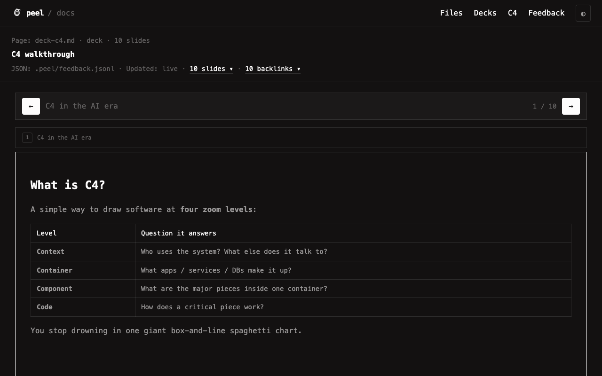
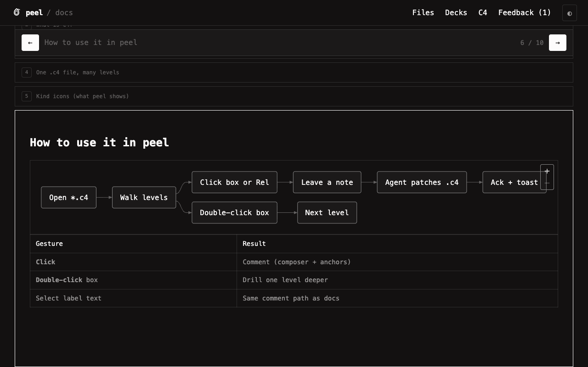

# View a deck

Decks are markdown with `marp: true` in the frontmatter. Each `---` section is one slide. Side panels start closed so slides get the width. (`---` inside fenced code does **not** split slides.)

Dogfood decks:

| Deck | Job |
|---|---|
| [[deck-peel-tour]] | Five-minute product pitch |
| [[deck-use-cases]] | Four jobs peel wins |
| [[deck-c4]] | C4 walkthrough for newcomers (AI-era why + how) |
| [[deck-demo]] | Minimal smoke target for the agent loop |



## Move between slides

- `←` / `→` in the control bar or on the keyboard
- `Home` / `End` for first and last
- Click a collapsed title strip to jump
- Outline or headings dropdown in the meta line

The counter reads `3 / 13`. Scroll-spy keeps it honest when you wheel by hand.



## Link to a slide

URL carries `?file=deck-peel-tour.md&slide=3`. Share or reload lands on that slide. Browser back leaves the deck page, not the previous slide index.

## Diagrams on slides

Fenced ` ```mermaid ` blocks render via pele (same engine as C4). Keep diagrams focused — one idea per slide. Wikilinks like `[[agent-loop]]` resolve when you present.



## Annotate

Select text or diagram labels on the open slide, then Save. Jumping from Feedback expands the right slide first. Anchors include `slide` (1-based). Guide: [[annotate]].
