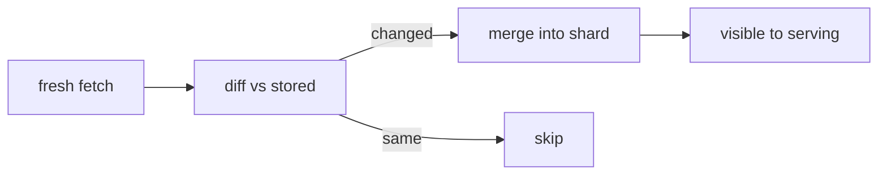

# ADR: Incremental freshness vs batch rebuild cost

Long-form rationale behind [[decisions]] D1. Touches [[crawling]],
[[indexing]], [[storage]] and [[serving]] freshness paths.

## Context

Early web search rebuilt the index in giant batch jobs (MapReduce over
a snapshot). Simple and consistent — but the world moved on between
rebuilds, and each rebuild reprocessed unchanged pages.

## Decision

Move to continuous incremental updates (Caffeine/Percolator lineage):
changed pages flow from [[crawling]] into [[indexing]] within minutes
[assumption: exact SLA not public], postings merge per shard.

## Consequences

- **Freshness** becomes a frontier-scoring problem, not a batch schedule.
- **Write amplification** on [[storage]]: constant small merges vs rare
  bulk loads — compaction and tiering absorb it.
- **Consistency** weakens: two shards may briefly disagree; [[serving]]
  already tolerates approximation under deadlines.
- **Rollback** gets harder: no single "last good snapshot"; mitigated by
  versioned shard generations [sane guess: standard practice].
