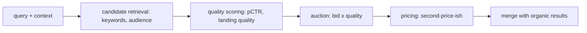

# Ads Targeting

The monetization path running beside organic [[serving]] and [[ranking]].
Auction state lives in [[storage]] (Spanner); candidates merge at blend.

Public mechanics (AdWords-era, still the shape): advertisers bid on
keywords; rank = bid × quality score; winners pay roughly the minimum
needed to hold position. Exact modern formulas are not public
[assumption: details inferred, shape stable].

## Targeting dimensions

- Query keywords and match types.
- Geography, language, device, time.
- Remarketing / audience lists, demographics [assumption: set evolves].

Blending with organic results must preserve trust: ads are labelled and
separated; a bad merge poisons the product. See [[decisions]].
