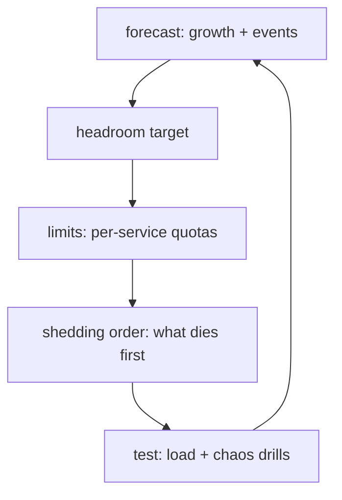

# Capacity Planning

Headroom is a feature. Decides whether the events in [[outages]] stay
small. Covers [[serving]], [[grpc]], [[caching]], [[storage]] and
[[database-reliability]].

## Practices

- **Quota everything** — CPU, RPCs, [[storage]] bytes, cache footprint.
  No quota = shared fate with your noisiest neighbour.
- **Define the shedding order in advance** — e.g. drop prefetch, then
  ads richness, then shard coverage, then fail. Decided calmly in this
  doc, not at 3am.
- **Load-test to breaking monthly** — find the cliff on purpose;
  [[outages]] catalogues what the cliff looks like.
- **Events need reservations** — launches, holidays, crawls after a
  [[crawling]] backlog: pre-provision, don't hope.
- **Alarms on leading indicators** — queue depth, retry rate, cache
  ratio — not on the outage itself.

[Sane guess: exact headroom percentages are org-specific; the loop
above is the standard industry shape.]
