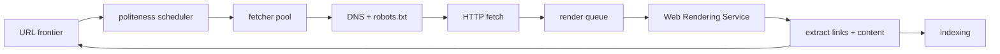

# Crawling

Discovery and fetching of the web. Feeds [[indexing]]; paced by politeness
and budget. See [[overview]] for where this fits.

## Frontier

The URL frontier holds billions of URLs scored by importance
(PageRank, update frequency, sitemap hints). [Assumption: exact scoring
weights are not public.]

## Stages

1. **DNS + robots.txt** — cached aggressively; a slow robots fetch blocks a host.
2. **HTTP fetch** — conditional GETs (ETag / Last-Modified) save bytes.
3. **Render** — headless Chromium (Web Rendering Service) executes JS;
   mobile-first indexing means the mobile viewport is canonical.
4. **Extract** — links re-enter the frontier with discovered URLs.

## Politeness

- Per-host crawl-delay honouring plus adaptive backoff on 5xx / slow TTFB.
- Sitemaps and `lastmod` steer budget toward changed pages.

Duplicates collapse via content fingerprinting (simhash-style) before
[[indexing]] ever sees them. Freshness pressure is detailed in
[[2026-10-25-adr-incremental-index-freshness-vs-batch-rebuild-cost-tradeoff]].
