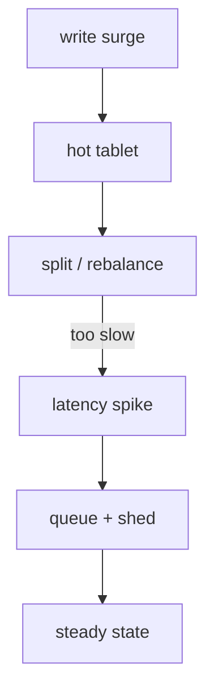

# Database Reliability

What breaks in the data layer: hotspots, transactions, schema change.
Backs [[indexing]] (Bigtable webtable), [[ads-targeting]] (Spanner),
[[serving]] reads. General patterns: [[outages]].

## Failure modes

- **Hotspotting** — monotonically increasing keys (timestamps, sequential
  IDs) hammer one range. Fix: hash-prefix or field-promotion salting.
- **Split storms** — too-aggressive tablet splits after a surge; merges
  lag behind, metadata churn amplifies load.
- **Long transactions** (Spanner) — hold locks across a slow [[grpc]]
  call and everything behind them queues. Keep transactions tight and
  conflict-free by design.
- **Schema migration** — backfill + dual-read phases; a missed backfill
  window reads half-migrated rows. Roll forward, never "quick rollback".
- **Replica lag** — stale reads served as fresh; version vectors or
  read-your-write routing where it matters.

Capacity headroom decides whether these are incidents or footnotes:
[[capacity-planning]].
