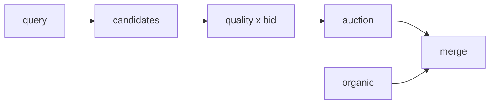
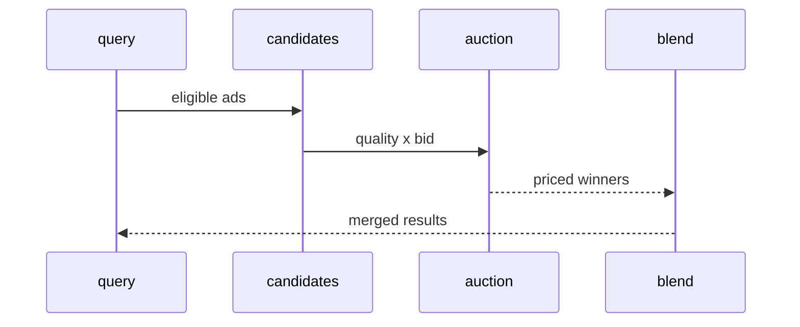
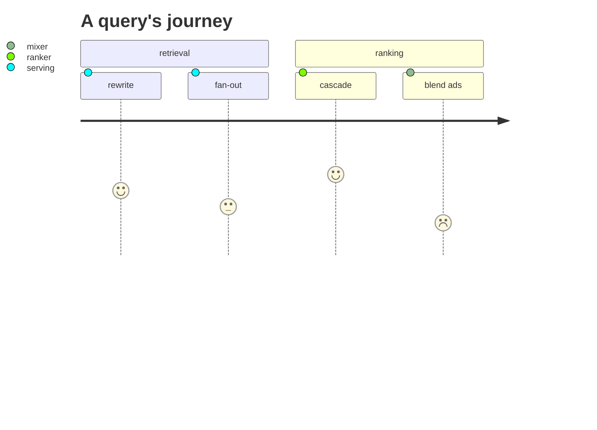
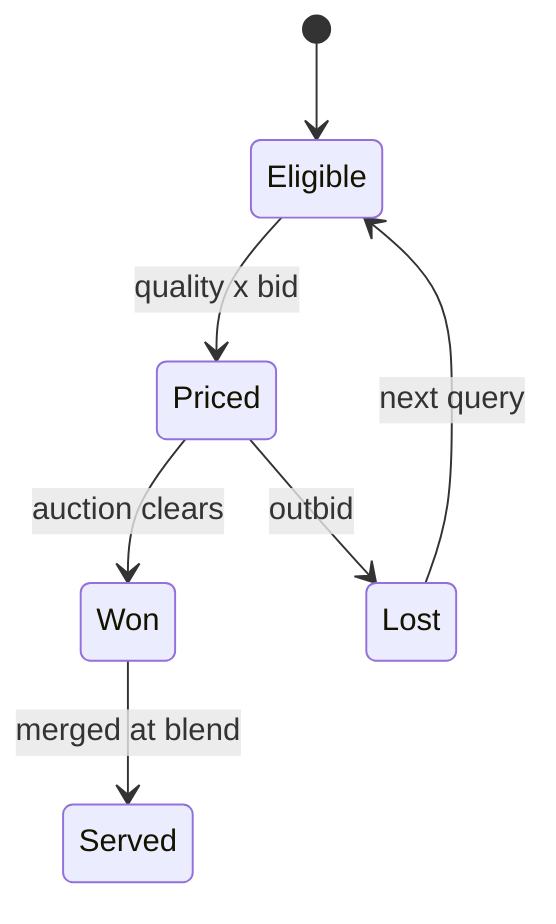
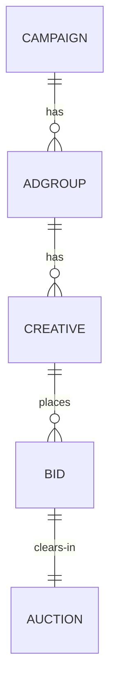
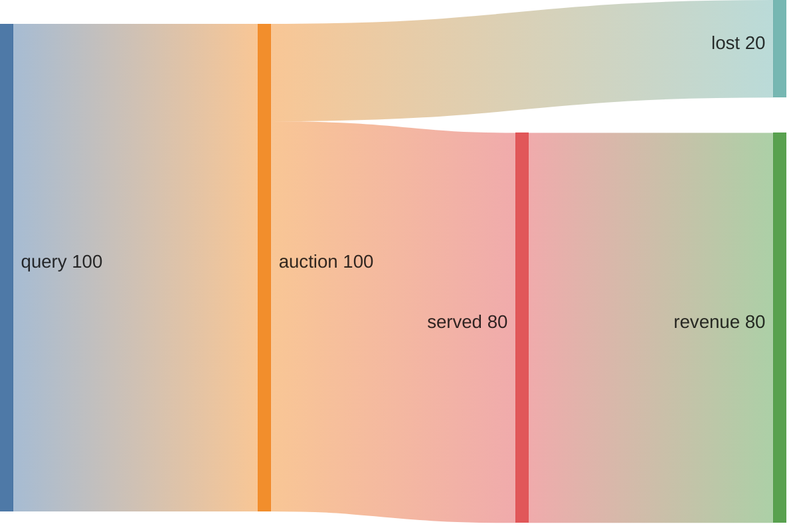
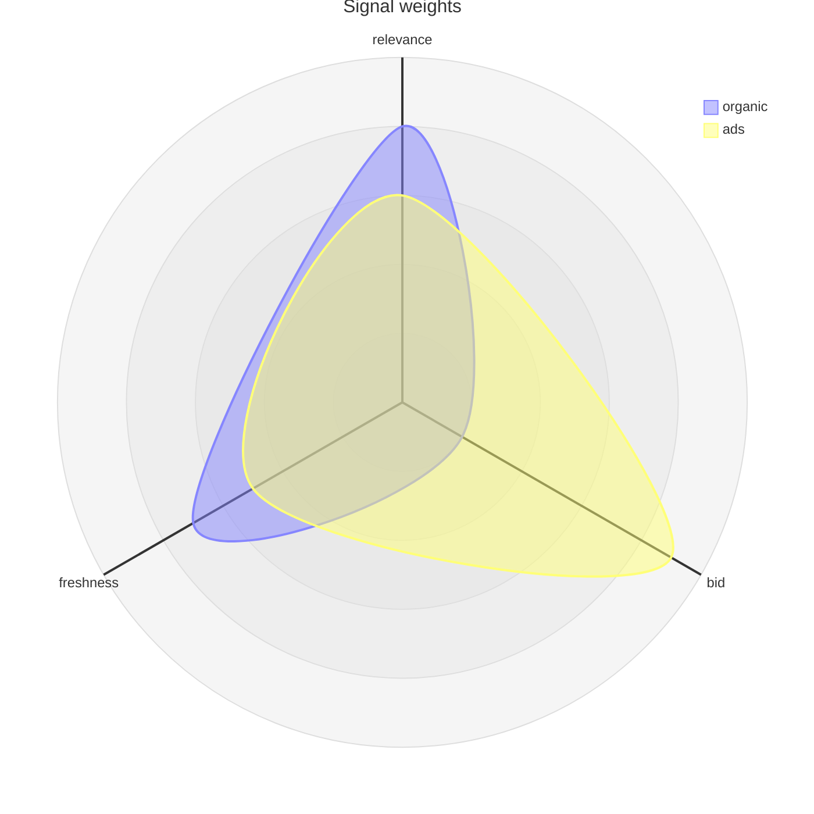
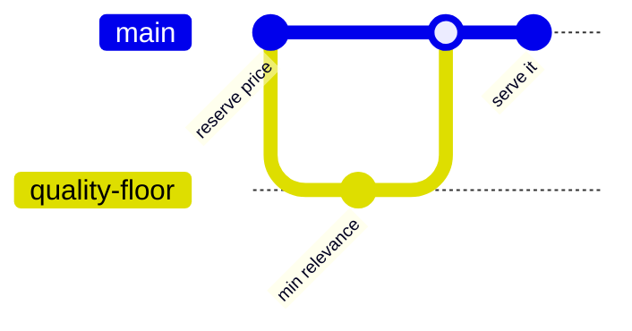
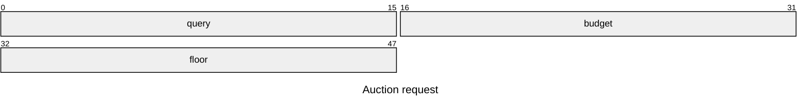

# Queries become revenue

Parallel pipeline, merged at blend.

Scrutiny flows: every money step is inspectable.

---

## Parallel pipeline

Organic [[ranking]] iterates independently of money. See [[ads-targeting]].

---

## Auction scrutiny

Each handoff is logged. Audit any impression. See [[decisions]] D3.

---

## A query's journey

Blend scores lowest today. That is the scrutiny backlog. See [[serving]].

---

## Auction state

Losers return to eligibility. No sticky losers. See [[database-reliability]].

---

## Entities behind money

Campaigns own groups own creatives. Bids clear per query. See [[storage]].

---

## Money flow

Four of five queries monetize in this sketch. Real split: [[ads-targeting]].

---

## Quality signals

Organic leans relevance, ads lean bid. Blend weights both. See [[ranking]].

---

## Policy change history

Pricing changes ship like code. Review trail: [[decisions]].

---

## Request layout

Fixed offsets, parsed once. Contract: [[api-design]].

---

## Under the same deadline

Scoring and pricing inside the [[serving]] millisecond budget.

- Auction runs beside ranking, never before it.
- Over budget: serve organic, drop priced ads.

---

## State in Spanner

Transactional auction state in [[storage]].

- Exactly-once impression logging.
- Replays for billing disputes.

---

## Open questions

- Should blend weights vary by query class?
- Reserve price per vertical or global?
- Who owns the scrutiny dashboard?

Parked in [[decisions]] D3. Challenge them.
