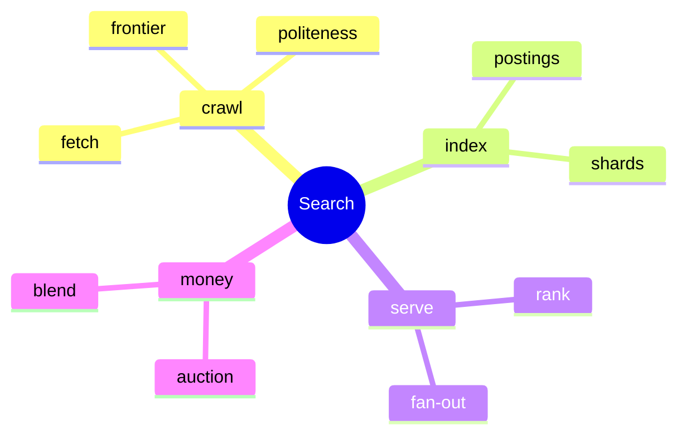
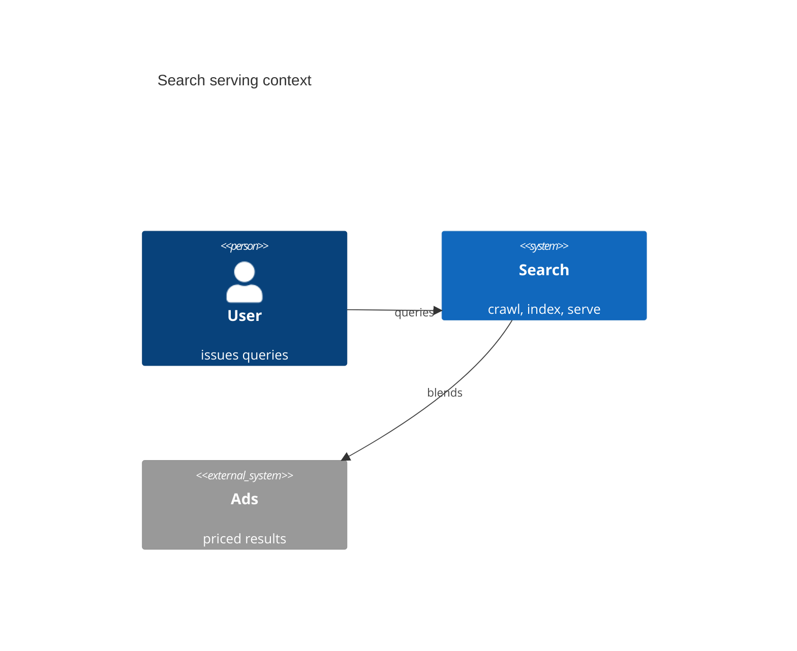
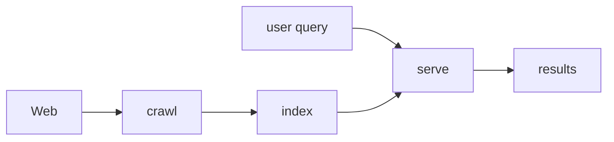
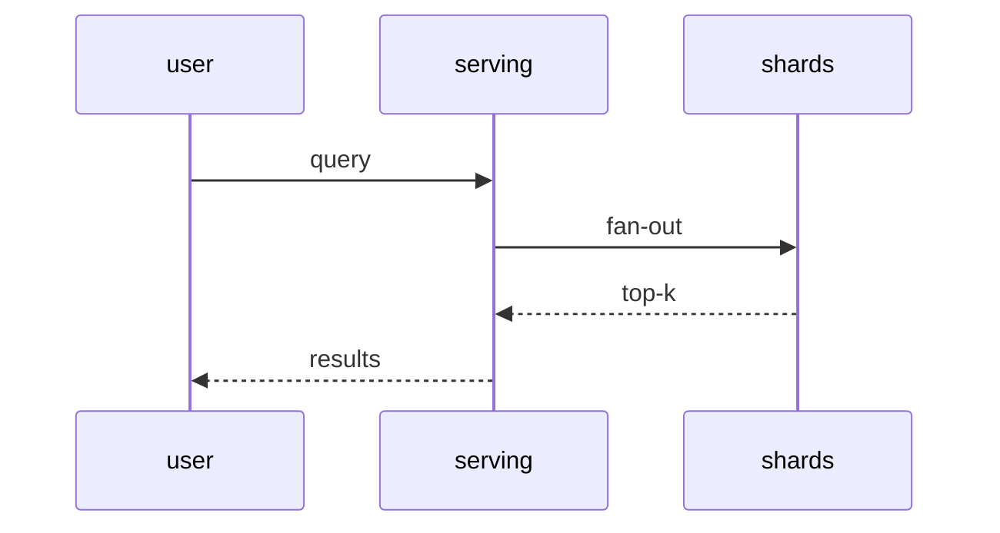
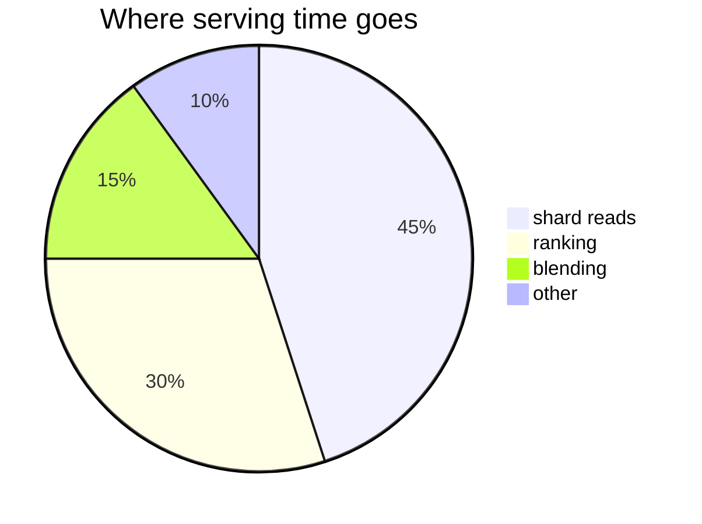
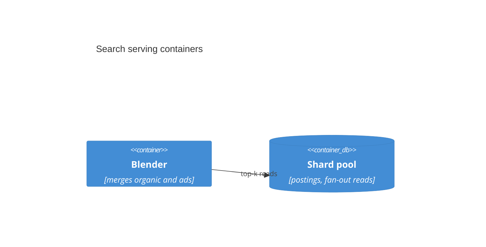
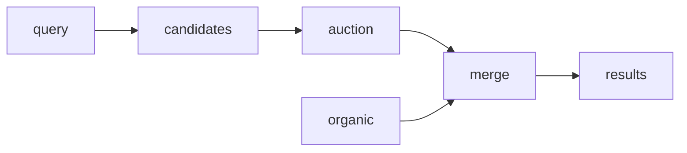
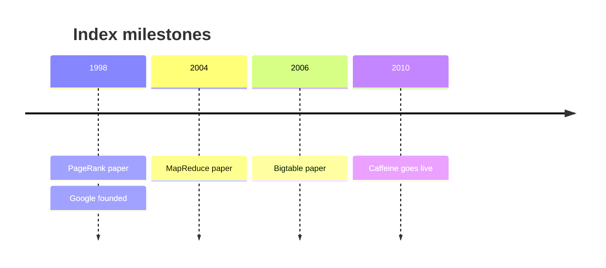

# Search in five minutes

Crawl the web, index it, serve it. Money via ads.

Audience: anyone new. Time: five minutes.

---

## Map of this talk

Four stages, one loop. Details: [[overview]].

---

## System context

Two systems, one results page. Details: [[overview]].

---

## The loop

- Crawl discovers pages.
- Index makes them retrievable.
- Serve answers queries.

---

## A query's path

Fan-out, gather, rank, blend. Details: [[serving]].

---

## Where serving time goes

Reads dominate. Cache them. Details: [[caching]].

---

## Serving containers

Blend first, shards second. Details: [[serving]], [[api-design]].

---

## Crawl: discover the web

Frontier → politeness → fetch → render → extract.

- Politeness caps per-host rate.
- Render executes JS before extract.

See [[crawling]].

---

## Index: build once, read billions

Tokens → postings → shards by docid.

- Incremental updates, not rebuilds.
- Skip lists for fast intersections.

See [[indexing]] and [[deck-indexing-deep-dive]].

---

## Serve: decide in milliseconds

Rewrite → fan-out → cascade rank → blend.

- gRPC fan-out, tight deadlines.
- Organic and ads scored apart, merged at blend.

See [[serving]] and [[grpc]].

---

## Money beside organic

Auction beside ranking, merged at blend. See [[ads-targeting]] and [[deck-ads-monetization]].

---

## Index milestones

Batch, then incremental. See [[2026-10-25-adr-incremental-index-freshness-vs-batch-rebuild-cost-tradeoff]].

---

## Where to go next

| If you want | Read |
|---|---|
| Crawl details | [[crawling]] |
| Index freshness | [[deck-indexing-deep-dive]] |
| Money pipeline | [[deck-ads-monetization]] |
| Vocabulary | [[glossary]] |
