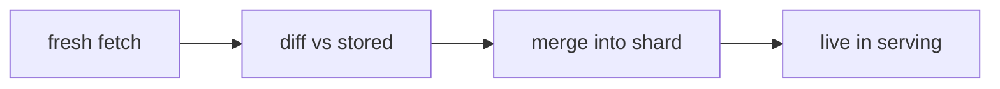
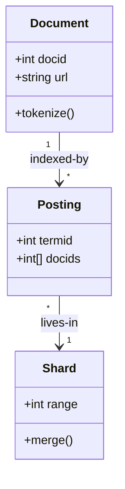
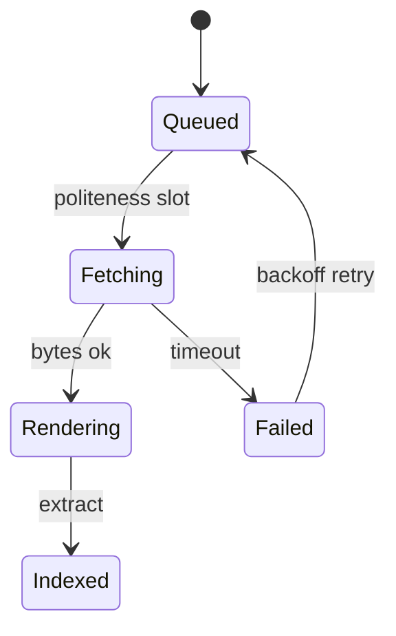
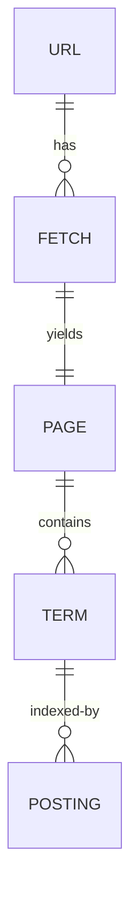
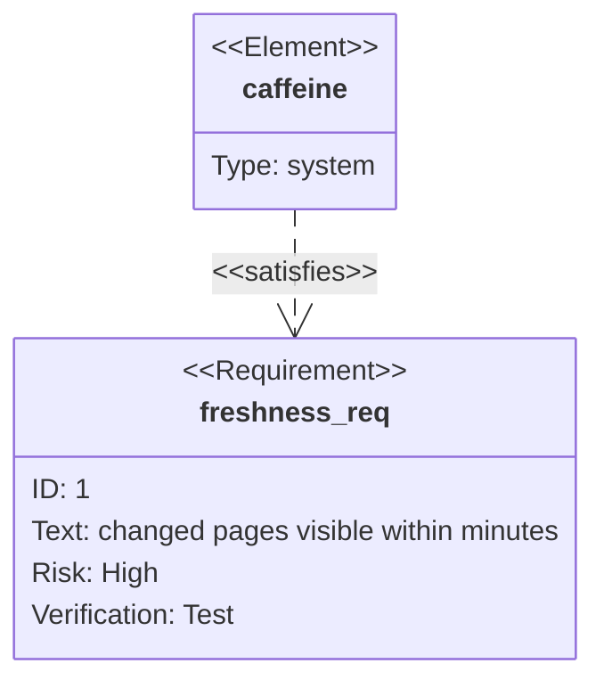
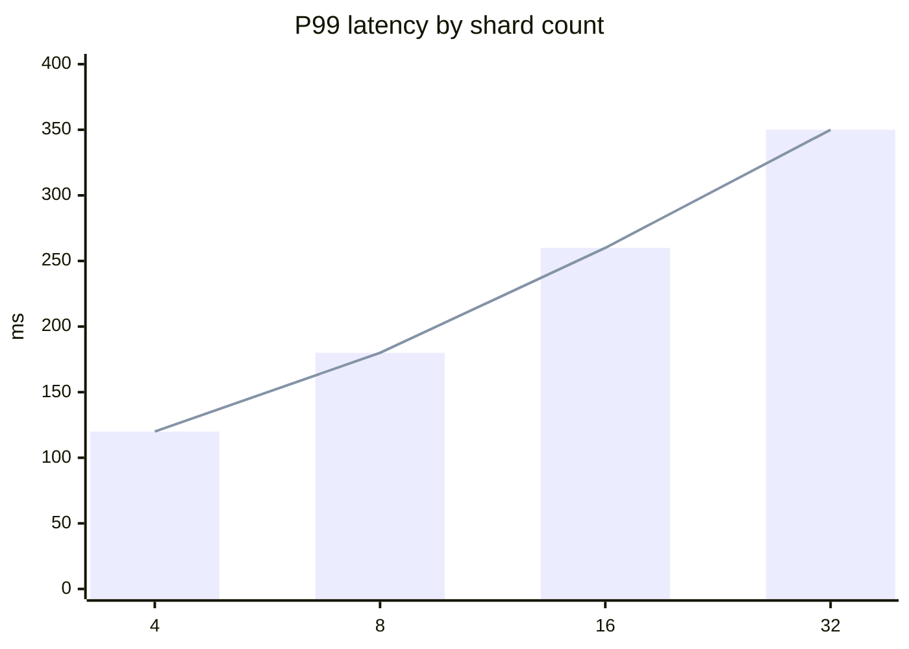
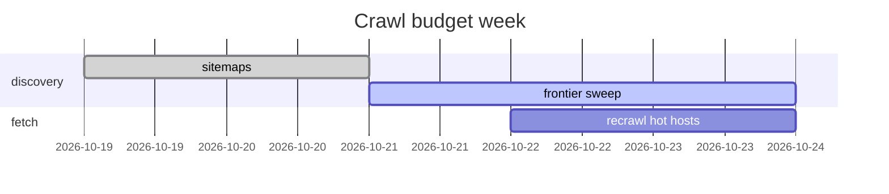
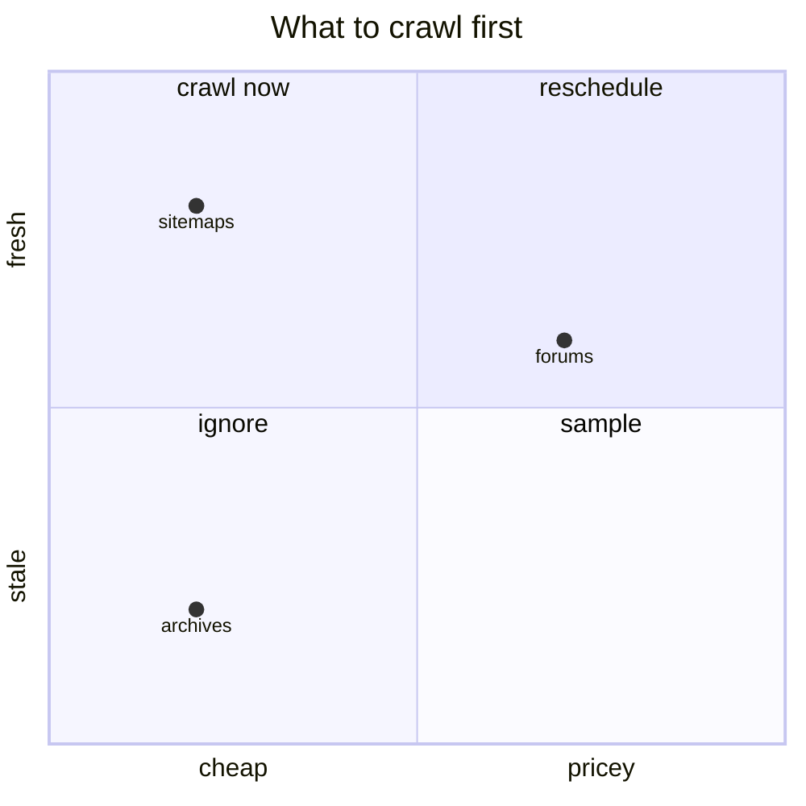
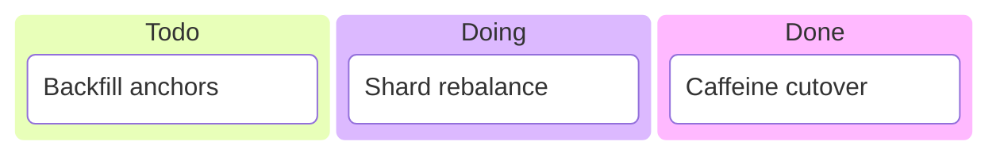

# Keeping the index fresh

From batch rebuilds to Caffeine.

Design deep dive: structures, flows, costs.

---

## Old world: batch

Snapshot the web, MapReduce everything, swap the index.

- Simple. Consistent. Stale.
- Every rebuild reprocesses unchanged pages.

---

## New world: incremental

Changed pages flow from [[crawling]] into [[indexing]] within minutes.

See [[2026-10-25-adr-incremental-index-freshness-vs-batch-rebuild-cost-tradeoff]].

---

## Structures that allow it

Lexicon + postings + skip lists, sharded by docid. See [[indexing]].

---

## A document's lifecycle

Every state is observable. Failures requeue, never drop. See [[crawling]].

---

## Entities involved

Crawl facts feed index facts. See [[storage]].

---

## The freshness contract

Assumption: exact SLA not public. Tracked in [[decisions]] D1.

---

## Latency vs scale

More shards, more fan-out tax. Numbers illustrative. See [[capacity-planning]].

---

## Crawl budget week

Hot hosts first, archives when cheap. See [[crawling]].

---

## What to crawl first

Freshness per cost, not per URL. See [[bottlenecks]].

---

## Cutover tracking

Migration state at a glance. History: [[outages]].

---

## Price paid

- Write amplification on every merge.
- Weaker consistency across shards.
- Harder rollback than a snapshot swap.

Worth it: freshness wins. See [[bottlenecks]] and [[decisions]].
