# Diagram Gallery

Every renderer path in one place, themed to [[overview]].
If a block below shows an error instead of a picture, the syntax needs
fixing — that is the point of this file.

## Flowchart

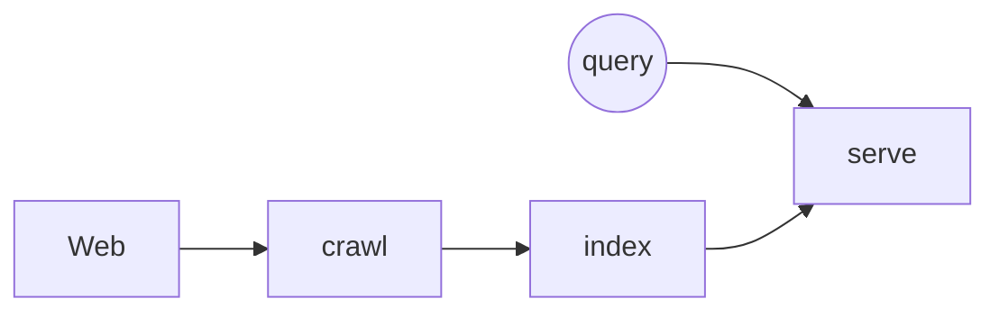

## Sequence

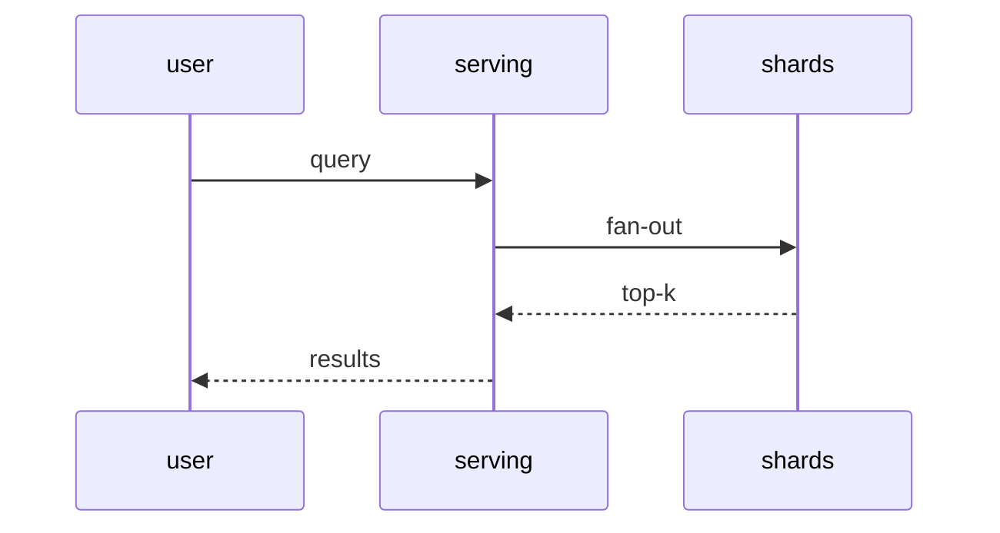

## Class

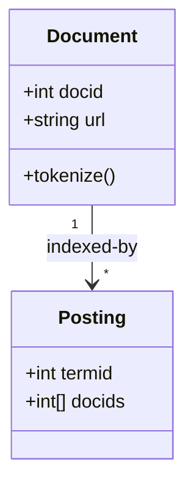

## State

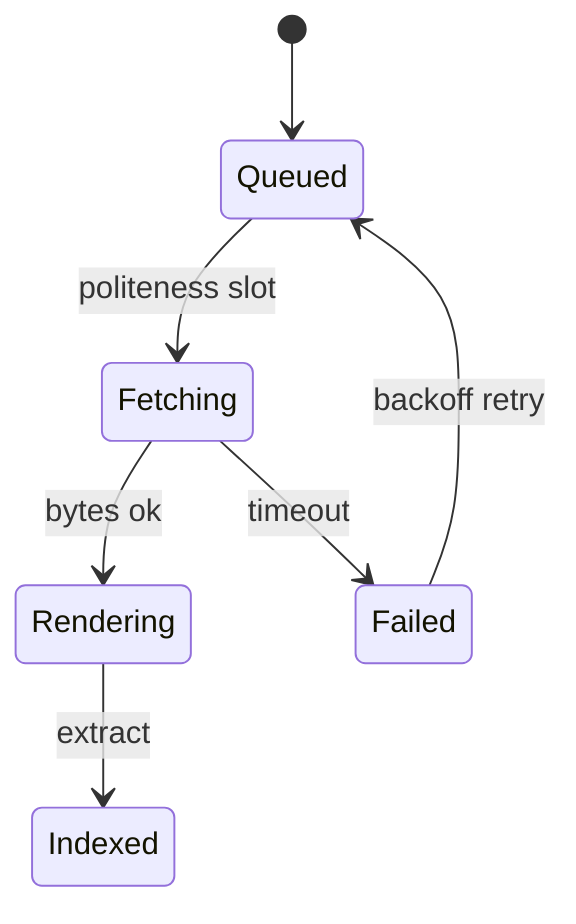

## Entity relationship

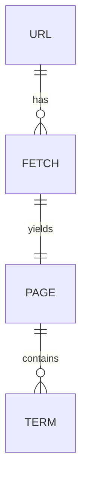

## Gantt

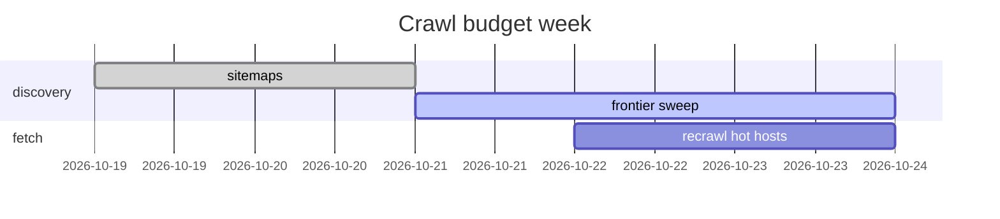

## Git graph

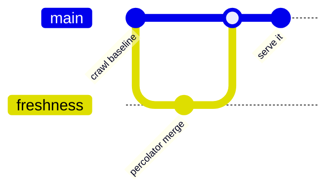

## Mindmap

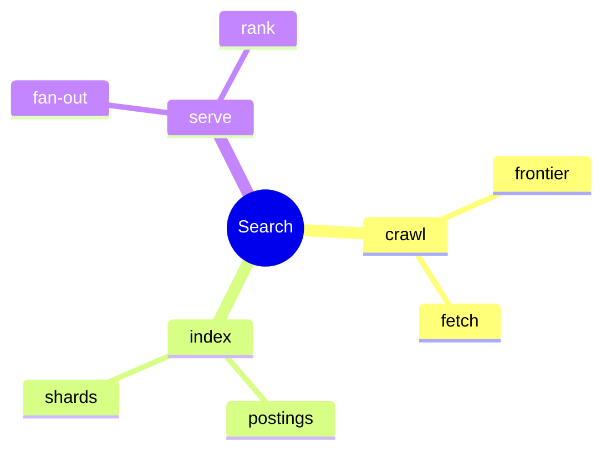

## Pie

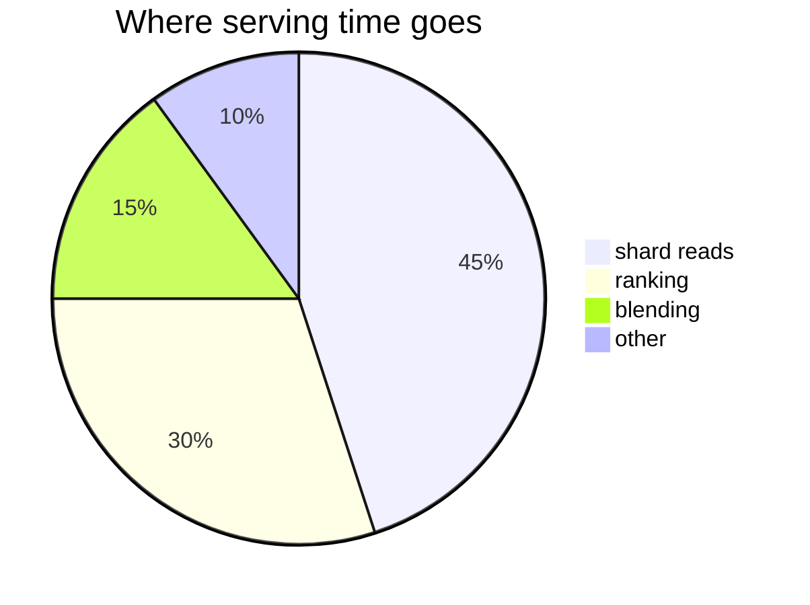

## Timeline

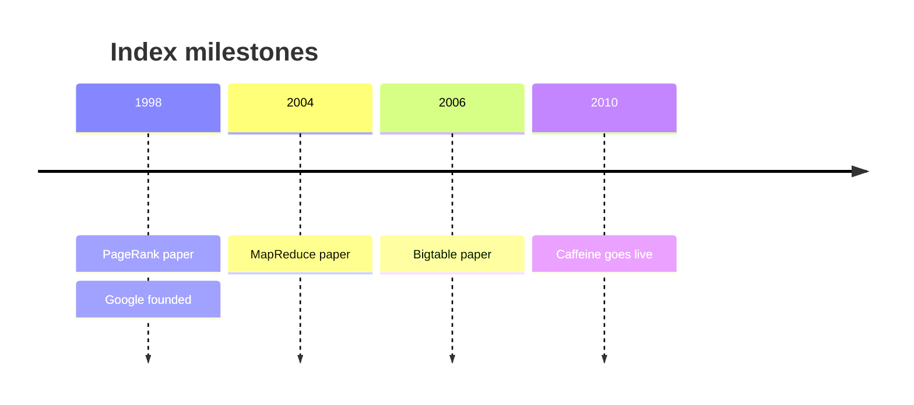

## Journey

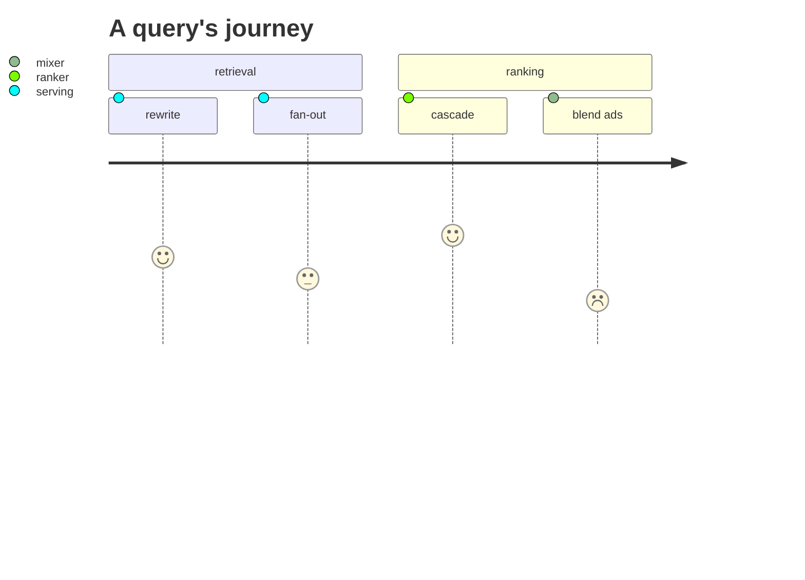

## Kanban

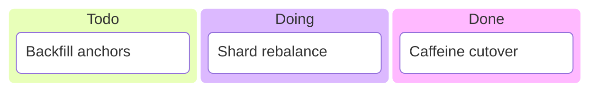

## Quadrant

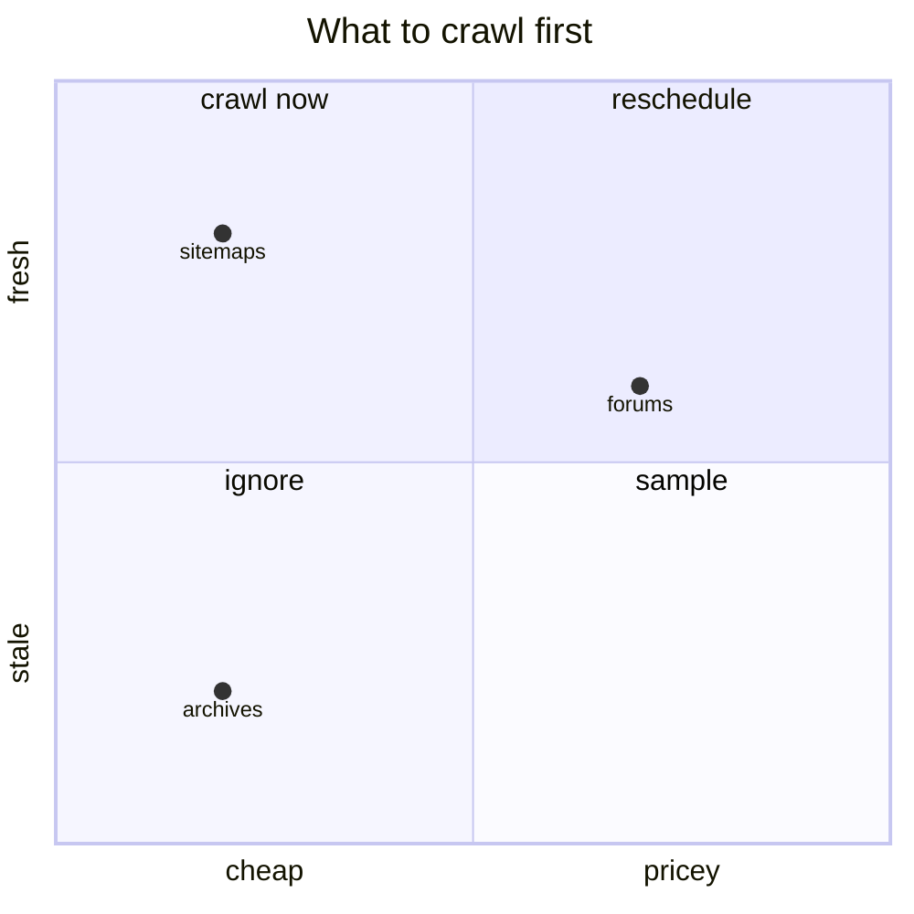

## Requirements

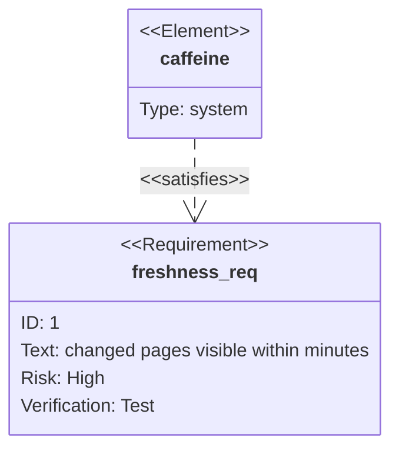

## XY chart

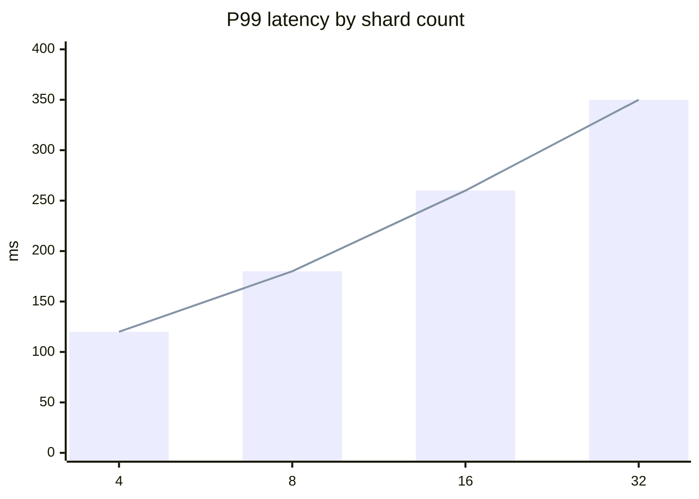

## C4

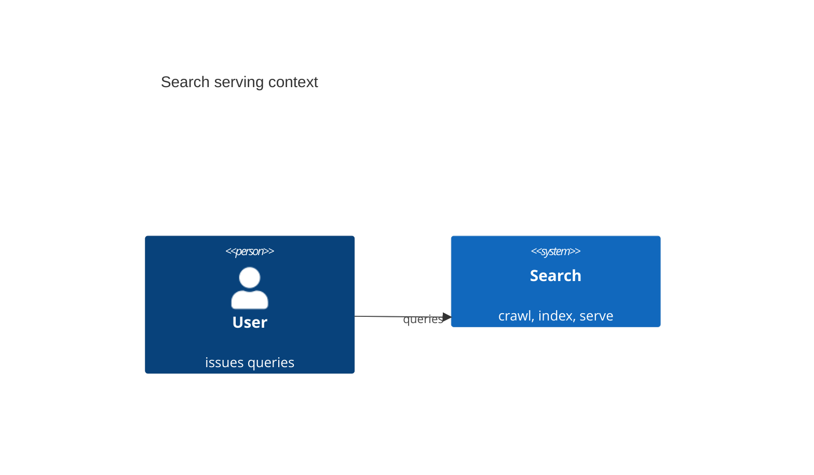
