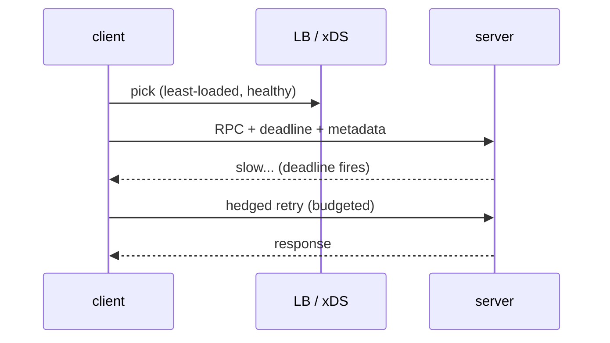

# gRPC (Stubby lineage)

The transport everything breaks *through*. Underpins [[serving]]
fan-out, [[api-design]] contracts, and [[storage]] access.

## Knobs that matter in an outage

- **Deadlines propagate** — each hop subtracts elapsed time; a server
  that ignores the incoming deadline invents latency (see [[outages]]).
- **Retry budgets** — e.g. max N% of traffic as retries; beyond that,
  fail fast instead of joining the storm.
- **Hedging** — after p99 wait, send a second request; first reply wins.
  Same mechanism as [[serving]] shard reads.
- **Load balancing** — client-side, health-aware; a bad balancer sends
  the thundering herd to one replica ([[caching]], [[capacity-planning]]).
- **Backpressure** — server concurrency caps + queued-with-timeout beat
  unbounded queues every time.

[Sane guess: parameter values vary by service; the mechanisms above are
the public, documented shape.]
