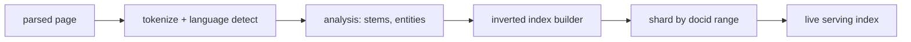

# Indexing

Turns fetched pages into retrievable structures. Consumes [[crawling]]
output; serves [[serving]] reads. Glossary: [[glossary]].

## Pipeline

Since Caffeine (2010, built on Percolator incremental processing), the
index updates continuously instead of in one giant batch rebuild —
see [[decisions]] and the long-form
[[2026-10-25-adr-incremental-index-freshness-vs-batch-rebuild-cost-tradeoff]].

## Core structures

- **Lexicon** — term → term-id dictionary, memory-resident per shard.
- **Postings** — per term: sorted docid lists with positions, skip lists,
  compressed (delta + variable-byte style encodings).
- **Document store** — fields, anchors, metadata in [[storage]] (Bigtable).

## Sharding

Index is partitioned (by docid ranges [assumption: exact scheme not
public]) so each shard fits its serving hosts; [[serving]] fans out to
all shards per query. Replica sets absorb host failures.
