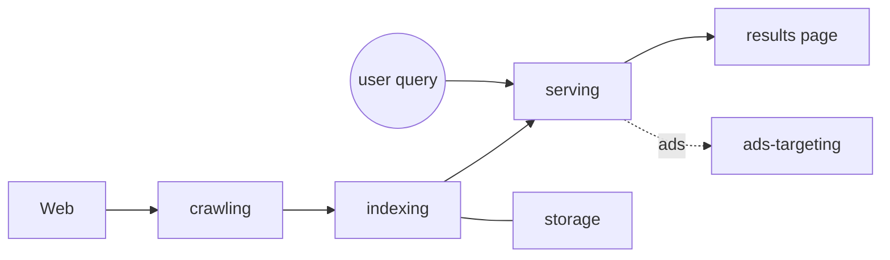

# Google Search Architecture

How web search works end to end: [[crawling]] discovers pages,
[[indexing]] organises them, [[ranking]] orders them, and [[serving]]
delivers answers in milliseconds. Money arrives via [[ads-targeting]].
Everything persists in [[storage]].

## The three pipelines

| Pipeline | Job | Key pressure |
| --- | --- | --- |
| [[crawling]] | Discover + fetch the web | Politeness, freshness |
| [[indexing]] | Build retrievable structures | Update latency, size |
| [[serving]] | Answer queries fast | Tail latency |

Cross-cutting concerns live in [[bottlenecks]] and the vocabulary in
[[glossary]]. Major trade-offs are recorded in [[decisions]].
A deeper rationale for incremental updates is in
[[2026-10-25-adr-incremental-index-freshness-vs-batch-rebuild-cost-tradeoff]].

## Slide versions

- [[deck-executive-overview]] — the 5-minute story
- [[deck-indexing-deep-dive]] — how the index stays fresh
- [[deck-ads-monetization]] — how queries become revenue
