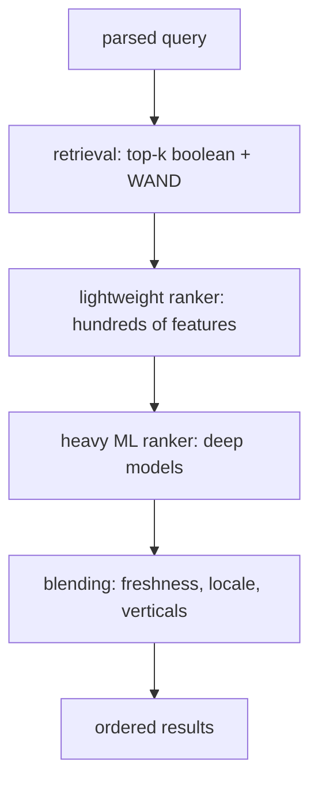
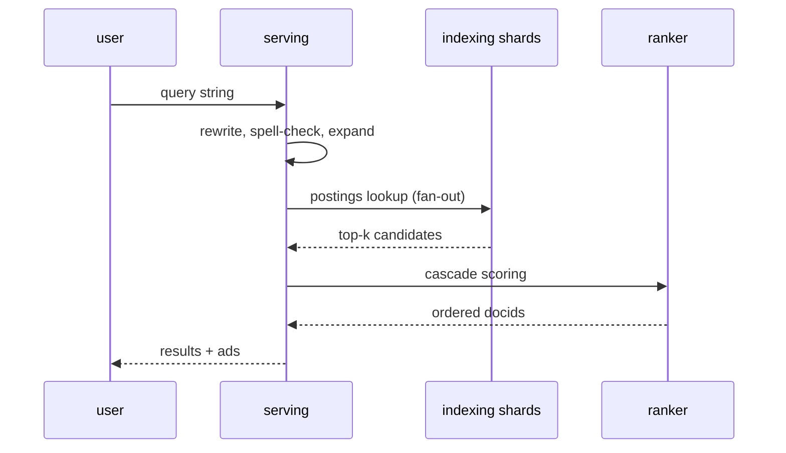

# Ranking

Orders candidates retrieved from [[indexing]]. Runs inside [[serving]]
under a strict deadline; see [[bottlenecks]] for tail-latency pressure.

## Cascade

Public milestones: PageRank (1998), Hummingbird (2013, conversational
query understanding), RankBrain (2015), neural matching with BERT (2019),
MUM (2021, multimodal). Exact current signals are not public
[assumption: cascade shape inferred from eng talks and papers].

## Query path

Spelling and synonyms expand recall before retrieval; the auction in
[[ads-targeting]] runs in parallel and merges at blend time.
