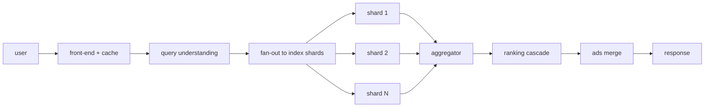

# Serving

Answers queries in ~hundreds of milliseconds. Reads [[indexing]] shards,
invokes [[ranking]], blends [[ads-targeting]]. Parent: [[overview]].

## Latency discipline

- **Deadlines everywhere**: every fan-out has a budget; slow shards get
  dropped (slightly worse results beat slow results).
- **Hedged requests** (Dean–Barroso "tail at scale"): re-issue slow
  shard reads elsewhere after a percentile wait.
- **Layered caches**: results cache, postings cache, doc-store cache
  in front of [[storage]].

Failure handling: replica shards, graceful degradation (fewer shards,
cheaper ranker) before errors. More in [[bottlenecks]].
