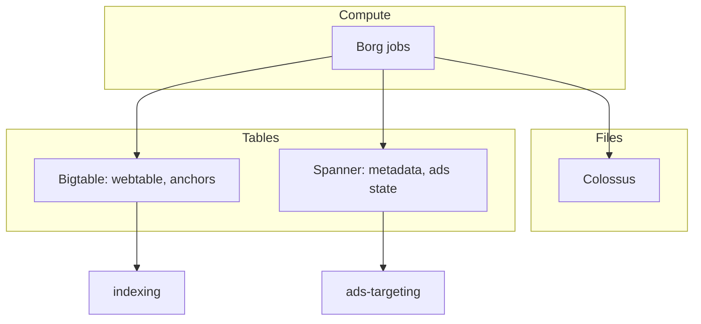

# Storage

Durable substrate under [[crawling]], [[indexing]] and [[serving]].
Public lineage: GFS (2003) → Colossus; MapReduce (2004);
Bigtable (2006); Spanner (2012). Compute runs on Borg; RPC via
Stubby/gRPC [sane guess: names current, internals evolved].

## Who stores what

| Data | Home | Access pattern |
| --- | --- | --- |
| Raw fetches | Colossus | Write-once, scan |
| Webtable + anchors | Bigtable | Row reads, bulk scans |
| Index shards | Colossus + local SSD | Bulk load, mmap reads |
| Ads/auction state | Spanner | Transactional |

Locality matters: index shards are pushed near [[serving]] hosts;
rebuilds stream from Colossus at datacenter-network rates.
